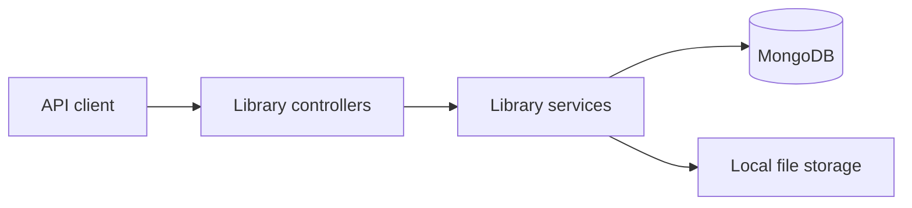

# Marine Guard

**Coral reef monitoring and marine conservation · Team project**

Marine Guard is designed to bring field observations, coral bleaching assessments, conservation alerts, and educational resources into one platform. The code in this snapshot is most developed in the **Marine Resource Library**, which supports public browsing and lets content managers organize and publish resources.

## Stakeholders

| Stakeholder | How they would use Marine Guard |
| --- | --- |
| Divers and field observers | Record reef observations, attach photos, and provide location and field context. |
| Marine scientists and reef specialists | Review observations, assess bleaching severity, and interpret trends for research or conservation planning. |
| Conservation NGOs and field coordinators | Coordinate follow-up work, share alerts, track tasks, and curate educational resources. |
| Platform administrators | Manage library content and categories. Account and access management are part of the wider platform scope. |
| Students, educators, and the public | Browse published marine conservation resources such as articles, PDFs, videos, and infographics. |

The stakeholder table describes the intended audience. The library controllers declare `ADMIN` and `NGO` roles for management operations. This snapshot includes a security configuration stub, so runtime enforcement of those roles has not been verified.

## Features and implementation status

| Module | Scope | Status in this snapshot |
| --- | --- | --- |
| Marine Resource Library | Search and filter resources, browse categories, view featured and popular items, and record views, downloads, likes, and shares. | Public controller, services, and MongoDB repositories present. |
| Library Administration | Manage categories and subcategories, upload items, edit metadata, and publish or unpublish resources. Includes bulk operations and statistics. | Admin and category controllers and service code present. |
| Field Observations | Capture, edit, and review reef observations and related photos. | Controller and frontend placeholders. |
| AI-Assisted Bleaching Assessment | Analyze coral images and present an assessment for specialist review. | Planned. Model files and an inference service are absent from this snapshot. |
| Alerts and Follow-up Tasks | Notify stakeholders about observations and track follow-up work. | Controller and frontend placeholders. |
| Reporting | Summarize observations and support conservation reporting. | Controller and frontend placeholders. |
| Accounts and Profiles | Support registration, login, password recovery, and user profiles. | Scaffolding. |

## Example workflows

### Marine Resource Library

1. An NGO content manager or administrator creates a category and adds a resource.
2. The manager updates its metadata and publishes it.
3. A public visitor browses or searches published resources, opens a resource, and downloads it when a file is available.

### Planned reef monitoring workflow

1. A diver submits a reef observation with a photo and location details.
2. The system produces an AI-assisted bleaching assessment for a specialist to review.
3. A conservation coordinator reviews the assessment, shares an alert when appropriate, and assigns follow-up work.

## Architecture and technology

| Layer | Technology and responsibility |
| --- | --- |
| Frontend | `marineguard-frontend/` contains the planned screens, API modules, and shared component structure. The source files in this snapshot are empty and there is no development script. |
| Backend | Java 21, Spring Boot, Spring Web, and Maven. Library controllers handle requests, services implement library operations, and repositories manage persistence. |
| Database | Spring Data MongoDB. Main library collections are `categories` and `library_items`. |
| File storage | The backend includes a local library file storage service. The default directory is `uploads/library` and can be configured through `file.upload-dir`. |



### Library data model

| Document | Key information |
| --- | --- |
| `Category` | Name, description, parent category, tags, display order, and active status. |
| `LibraryItem` | Title, content type, category, tags, file and thumbnail URLs, language, difficulty, publication state, and engagement counts. |

## Selected API routes

| Method | Route | Purpose |
| --- | --- | --- |
| GET | `/api/library/categories` | List library categories. |
| GET | `/api/library/items` | Browse or search items by category, type, tag, difficulty, language, or keyword. |
| GET | `/api/library/items/featured` | List featured items. |
| GET | `/api/library/items/{id}/download` | Request a resource download. |
| POST | `/api/admin/library/items` | Create a library item. |
| POST | `/api/admin/library/items/{id}/publish` | Publish an item. |
| GET | `/api/admin/library/categories/{id}/subcategories` | List subcategories for a category. |

The routes above are declared in source. End-to-end execution has not been verified for this snapshot.

## Repository structure

```text
Marine-guard-main/
├── AIML-Project/
│   ├── src/main/java/com/marineguard/
│   │   ├── controller/
│   │   ├── model/
│   │   ├── repository/
│   │   └── service/
│   ├── src/main/resources/application.properties
│   ├── mvnw.cmd
│   └── pom.xml
├── marineguard-frontend/
│   ├── public/
│   ├── src/
│   └── package.json
└── README.md
```

## Backend setup on Windows

1. Install **JDK 21** and start a local MongoDB instance or make a hosted MongoDB database available.
2. In `AIML-Project/src/main/resources/application.properties`, set the MongoDB connection property to read from an environment variable.

   ```properties
   spring.data.mongodb.uri=${MONGODB_URI}
   ```

3. From the repository root, open PowerShell and run:

   ```powershell
   cd AIML-Project
   $env:MONGODB_URI = "mongodb://localhost:27017/marineguard"
   .\mvnw.cmd spring-boot:run
   ```

   For hosted MongoDB, use your connection string in the local PowerShell environment. Keep credentials out of commits.

4. If the backend starts on the default port, try `GET http://localhost:8080/api/library/categories`. The application needs a completed frontend and model integration to run the planned monitoring workflow.

## License

The backend includes an [MIT License](AIML-Project/LICENSE). 
